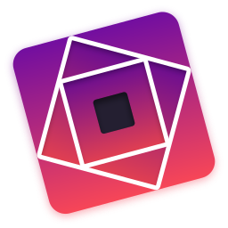

  

<h1 align="center">QuadraHQ</h1>

  

  A small team working on an open-source project that brings the macOS Roblox Player and Studio client to Linux through <a href="https://github.com/microlift/rosemary">Rosemary</a>, without losing most of the features a regular Windows Player would have (hopefully).

## Main projects

- [Quadra](https://github.com/QuadraHQ/Quadra-Rewrite): Run the macOS Roblox client on Linux.
- [Rosemary-Fork](https://github.com/QuadraHQ/rosemary-fork): A Rosemary fork made for Quadra, with lots of improvements and VR support for Roblox.

## Unmaintained but useful projects

- [CiderDarling](https://github.com/QuadraHQ/CiderDarling): A Darling fork for Quadra. You can probably daily drive this, but it's no longer worked on, as our focus is now the Rosemary fork.

## Links

- [Website](https://quadrahq.org)
- [Source code](https://github.com/QuadraHQ/Quadra)
- [Report an issue](https://github.com/QuadraHQ/Quadra/issues)

## Contributing

Contributions, bug reports, and suggestions are welcome. Feel free to open an issue or submit a pull request.

## Important

- Quadra is an independent open-source project.
- QuadraHQ is not affiliated with Roblox Corporation.
